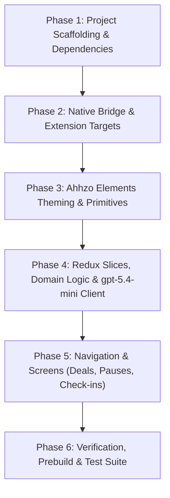

# Migration Blueprint: Volition iOS (Native Swift) to Expo + Ahhzo Elements

> **TARGET AGENT DIRECTIVE (Codex Goal Mode / Autonomous Runner)**:
> This document is an exhaustive, deterministic, step-by-step master execution plan for converting the **Volition** iOS Screen Time app from native Swift/SwiftUI (`OpenAppLock.xcodeproj`) to **Expo React Native** with **`@itsRares/ahhzo-elements`**.
>
> You must run autonomously under `/goal` mode. Do not make assumptions, do not skip stubs or leave "TODO" comments, do not invent arbitrary UI primitives, and do not remove existing domain invariants. Follow this plan phase by phase, executing verification commands after each step until the entire goal is met.

---

## 1. Executive Summary & Core Product Contract

### 1.1 Product Purpose
Volition is an intentional, conversation-first iOS Screen Time application. Users lock individual apps with an explicit name (1–600 chars), structured intention, and optional personal notes (up to 2,000 chars). A respectful AI coach (**`gpt-5.4-mini`** with medium decision reasoning) evaluates requests.

### 1.2 Access & Coaching Contract (Updated to latest HEAD)
1. **Unlock Durations**: Supports **1–60 minutes** (1–5 min for short check-ins, 6–60 min for deliberate work/lesson requests with clear justification).
2. **Progressive Interventions** (derived from confirmed grants in rolling past hour):
   - **0 grants**: Awareness or explicit choice.
   - **1 grant**: Suggested voluntary pause/delay (10–60s baseline, up to 1,800s if previous commitments were broken).
   - **2+ grants**: Negotiated **Deal** (access for X minutes, followed by an enforced **break of 1–1,440 minutes**).
3. **Pauses & Delays (Before Access)**:
   - 10-second delays start immediately; longer delays require explicit agreement.
   - Elapsed delay requires an explicit **Unlock** or **Keep locked** action (never auto-unlocks).
   - Pauses never enforce emotions: emotion check-ins appear first, but answering or tapping "Skip" simply reveals the intervention message.
4. **Negotiated Deals (Access THEN a Block)**:
   - Accepted 1–60 min grants atomically schedule an enforced break until `original expiry + break minutes`.
   - Overrides require two prior coach pushbacks and acceptance of a replacement deal with a longer break (remaining + 15 min, min 30 min, max 1,440 min).
   - Urgent/frustration relief: Credible emergency/frustration requests provide immediate relief without breaking the app, recorded durably in the commitment ledger.
5. **Three-Way Choice**:
   - Offers three explicit actions bound to the same duration: **Delay**, **Deal**, and a quieter **Open now** button.
6. **Emotion Check-Ins**:
   - Sampled check-ins with a persisted global **120-second cooldown** across all apps.
   - Presets plus custom text field (1–160 trimmed characters).
7. **Outcome Feedback**:
   - Confirmed unlock or keep-locked outcomes offer private **Helpful / Neutral / Annoying** ratings attached to the activity log.
8. **Reminders & Live Activities**:
   - Local alerts at 60s, 30s, and 10s remaining.
   - ActivityKit countdown widget via `@bacons/apple-targets`.

---

## 2. Tech Stack & Dependencies

Mirrors `@itsRares` companion projects ([`stash`](file:///Users/rares/Projects/stash), [`sight20`](file:///Users/rares/Projects/sight20), [`scoreup`](file:///Users/rares/Projects/scoreup)):

| Category | Package | Version | Purpose |
|---|---|---|---|
| **Core Framework** | `expo` | `~57.0.25` | Application framework |
| | `react` | `19.2.3` | UI runtime |
| | `react-native` | `0.86.3` | Mobile platform |
| **UI Library** | `@itsRares/ahhzo-elements` | `0.8.2` | Core component & theming library |
| | `@expo/vector-icons` | `^15.1.1` | SF Symbols / Ionicons provider |
| | `react-native-safe-area-context`| `~5.7.0` | Safe area handling |
| | `react-native-screens` | `~4.26.0` | Native view controllers |
| | `react-native-gesture-handler` | `~2.32.0` | Gestures & touch |
| | `react-native-reanimated` | `4.5.1` | Smooth transitions & animations |
| | `react-native-svg` | `15.15.4` | Vector graphics rendering |
| | `react-native-toast-message` | `^2.5.2` | Native toast notices |
| **Navigation** | `@react-navigation/native` | `^7.0.19` | Root navigation container |
| | `@react-navigation/bottom-tabs`| `^7.3.3` | Tab navigation (iPhone) |
| | `@react-navigation/stack` | `^7.2.3` | Stack modals & workflows |
| **State & Persistence** | `@reduxjs/toolkit` | `^2.6.1` | Global state management |
| | `react-redux` | `^9.2.0` | React Redux bindings |
| | `redux-persist` | `^6.0.0` | Durable state persistence |
| | `@react-native-async-storage/async-storage` | `2.2.0` | Storage engine |
| **System & Native** | `@bacons/apple-targets` | `^5.0.0` | Native Shield, Monitor & Live Activity targets |
| | `expo-build-properties` | `~57.0.22` | Static linking & deployment targets |
| | `expo-font` | `~57.0.4` | Custom font loading (Montserrat) |
| | `expo-haptics` | `~57.0.3` | Tactile feedback on actions |
| | `expo-sharing` | `~57.0.22` | Exporting activity logs & files |
| | `expo-file-system` | `~57.0.7` | File writing for exports |
| | `expo-splash-screen` | `~57.0.9` | Splash control |
| | `expo-status-bar` | `~57.0.1` | Themed status bar control |
| | `expo-notifications` | `~57.0.21`| 60s/30s/10s unlock alerts |
| | `expo-dev-client` | `~57.0.19` | Local native debug builds |

---

## 3. Directory Structure

```
volition-ios/
├── .npmrc                           # GitHub Packages auth for @itsRares/ahhzo-elements
├── App.tsx                          # Root provider tree (Theme, Redux, Safe Area, Nav)
├── app.json                         # Expo configuration, plugins, and entitlements
├── babel.config.js                  # Babel preset with module aliases
├── metro.config.js                  # Metro bundler config
├── tsconfig.json                    # Strict TypeScript configuration
├── package.json                     # Dependencies & scripts
│
├── modules/                         # Local Expo Modules
│   └── volition-screen-time/        # Native bridge for FamilyControls & ManagedSettings
│       ├── expo-module.config.json
│       ├── index.ts                 # TypeScript public API & types
│       └── ios/
│           ├── VolitionScreenTimeModule.swift
│           ├── VolitionAppIconView.swift
│           └── FamilyActivityPickerPresenter.swift
│
├── targets/                         # Native iOS Extension Targets (@bacons/apple-targets)
│   ├── shield-config/               # ShieldConfigurationExtension
│   │   ├── expo-target.config.js
│   │   └── ShieldConfigurationExtension.swift
│   ├── shield-action/               # ShieldActionExtension
│   │   ├── expo-target.config.js
│   │   └── ShieldActionExtension.swift
│   ├── activity-monitor/            # DeviceActivityMonitorExtension
│   │   ├── expo-target.config.js
│   │   └── DeviceActivityMonitorExtension.swift
│   ├── activity-report/             # DeviceActivityReportExtension
│   │   ├── expo-target.config.js
│   │   └── RuleUsageReport.swift
│   └── live-activity/               # ActivityKit Dynamic Island & Lock Screen Countdown
│       ├── expo-target.config.js
│       └── VolitionLiveActivity.swift
│
├── src/
│   ├── layout/                      # Theming & Root UI Layout
│   │   ├── VolitionThemeProvider.tsx# Ahhzo Elements ThemeProvider setup
│   │   ├── colors.ts                # Light/Dark palettes matching VolitionStyle
│   │   └── layout.ts                # Max width bounds, safe spacing
│   ├── navigation/                  # React Navigation setup
│   │   ├── AppNavigator.tsx         # Root gating (Onboarding vs Main tabs)
│   │   ├── MainTabNavigator.tsx     # 5 tabs: Chat, Apps, Insights, Focus, Settings
│   │   └── types.ts                 # Typed navigation params
│   ├── redux/                       # Redux store & slices
│   │   ├── store.ts                 # Store configuration & persistGate
│   │   ├── authSlice.ts             # Screen Time authorization & AI consent state
│   │   ├── appsSlice.ts             # Saved apps (tokens, names, intentions, notes)
│   │   ├── chatSlice.ts             # Messages, drafts, target token, pagination
│   │   ├── grantsSlice.ts           # Active grants, deals, breaks, delays, pending requests
│   │   ├── focusSlice.ts            # Focus sessions & scheduled recurring periods
│   │   ├── activityLogSlice.ts      # Private outcomes history + feedback ratings
│   │   └── settingsSlice.ts         # Coach tone, OpenAI API key, diagnostics
│   ├── services/                    # Domain logic & services
│   │   ├── openaiClient.ts          # Stateless gpt-5.4-mini client with strict schema & reasoning
│   │   ├── conversationCoordinator.ts # In-flight verification & deal validation engine
│   │   ├── appResolver.ts           # Saved app name router (replicates Swift logic)
│   │   ├── activityExport.ts        # Text & ISO-8601 JSONL export generator
│   │   ├── notificationService.ts   # 60s / 30s / 10s local alerts
│   │   └── diagnostics.ts           # Technical logging
│   ├── screens/
│   │   ├── onboarding/
│   │   │   ├── WelcomeScreen.tsx
│   │   │   ├── AIConsentScreen.tsx
│   │   │   ├── ScreenTimeGateScreen.tsx
│   │   │   └── SetupFirstAppScreen.tsx
│   │   ├── chat/
│   │   │   ├── ChatScreen.tsx       # App selector, grant timers, messages, composer
│   │   │   ├── EmotionCheckInSheet.tsx # 120s cooldown check-in sheet
│   │   │   ├── InterventionChoiceCard.tsx # Delay, Deal, Open 3-way choices
│   │   │   ├── DelayCountdownCard.tsx # Active pause seconds + Keep locked action
│   │   │   ├── OutcomeFeedbackCard.tsx # Helpful / Neutral / Annoying prompt
│   │   │   └── AppPickerModal.tsx   # Searchable modal sheet to switch target app
│   │   ├── apps/
│   │   │   ├── AppsScreen.tsx       # Saved apps list with status chips
│   │   │   └── AppEditorModal.tsx   # 3-step wizard (Picker -> Name -> Intention & Notes)
│   │   ├── insights/
│   │   │   └── InsightsScreen.tsx   # KPIs, 7-day volume chart, per-app breakdown
│   │   ├── focus/
│   │   │   └── FocusScreen.tsx      # Active session timer, duration picker, schedules
│   │   └── settings/
│   │       ├── SettingsScreen.tsx   # Main settings hub
│   │       ├── CoachSettingsScreen.tsx
│   │       ├── PrivacyDataScreen.tsx
│   │       ├── ActivityLogScreen.tsx# Outcome viewer & share sheet trigger
│   │       └── DiagnosticsLogsScreen.tsx
│   ├── components/                  # Shared domain widgets built with Ahhzo Elements
│   │   ├── VolitionCard.tsx         # Accentable themed card
│   │   ├── VolitionSectionHeading.tsx
│   │   ├── VolitionAppIcon.tsx      # Renders native token icon or mock fallback
│   │   └── ActiveGrantBanner.tsx    # Live countdown card with "End Unlock" action
│   └── copy/
│       └── strings.ts               # Exact copy catalog from Shared/Copy.xcstrings
```

---

## 4. Configuration Files & Setup

### 4.1 GitHub Packages Auth (`.npmrc`)
```ini
@itsRares:registry=https://npm.pkg.github.com
//npm.pkg.github.com/:_authToken=${GITHUB_TOKEN}
```

### 4.2 `package.json`
```json
{
  "name": "volition",
  "version": "1.0.0",
  "private": true,
  "main": "node_modules/expo/AppEntry.js",
  "scripts": {
    "start": "expo start --dev-client",
    "ios": "expo run:ios",
    "prebuild": "rm -rf ios && npx expo prebuild --clean",
    "typecheck": "tsc --noEmit",
    "lint": "eslint . --ext .js,.jsx,.ts,.tsx",
    "test": "jest --passWithNoTests"
  },
  "dependencies": {
    "@bacons/apple-targets": "^5.0.0",
    "@expo/vector-icons": "^15.1.1",
    "@itsRares/ahhzo-elements": "0.8.2",
    "@react-native-async-storage/async-storage": "2.2.0",
    "@react-navigation/bottom-tabs": "^7.3.3",
    "@react-navigation/native": "^7.0.19",
    "@react-navigation/stack": "^7.2.3",
    "@reduxjs/toolkit": "^2.6.1",
    "date-fns": "^4.1.0",
    "expo": "~57.0.25",
    "expo-build-properties": "~57.0.22",
    "expo-constants": "~57.0.19",
    "expo-dev-client": "~57.0.19",
    "expo-file-system": "~57.0.7",
    "expo-font": "~57.0.4",
    "expo-haptics": "~57.0.3",
    "expo-notifications": "~57.0.21",
    "expo-sharing": "~57.0.22",
    "expo-splash-screen": "~57.0.9",
    "expo-status-bar": "~57.0.1",
    "expo-system-ui": "~57.0.4",
    "react": "19.2.3",
    "react-dom": "19.2.3",
    "react-native": "0.86.3",
    "react-native-gesture-handler": "~2.32.0",
    "react-native-reanimated": "4.5.1",
    "react-native-safe-area-context": "~5.7.0",
    "react-native-screens": "~4.26.0",
    "react-native-svg": "15.15.4",
    "react-native-toast-message": "^2.5.2",
    "react-redux": "^9.2.0",
    "redux-persist": "^6.0.0"
  },
  "devDependencies": {
    "@babel/core": "^7.24.3",
    "@types/react": "~19.2.3",
    "babel-preset-expo": "~57.0.13",
    "typescript": "~6.0.3"
  },
  "overrides": {
    "react": "$react",
    "react-dom": "$react-dom",
    "typescript": "$typescript"
  }
}
```

### 4.3 `app.json`
```json
{
  "expo": {
    "name": "Volition",
    "slug": "volition",
    "scheme": "volition",
    "version": "1.0.0",
    "orientation": "portrait",
    "icon": "./assets/icon.png",
    "userInterfaceStyle": "automatic",
    "ios": {
      "bundleIdentifier": "com.a5karki.volition",
      "supportsTablet": true,
      "deploymentTarget": "18.0",
      "entitlements": {
        "com.apple.developer.family-controls": true,
        "com.apple.security.application-groups": [
          "group.com.a5karki.volition"
        ]
      },
      "infoPlist": {
        "ITSAppUsesNonExemptEncryption": false,
        "NSSupportsLiveActivities": true
      }
    },
    "plugins": [
      "@bacons/apple-targets",
      "expo-font",
      "expo-notifications",
      "expo-sharing",
      [
        "expo-build-properties",
        {
          "ios": {
            "deploymentTarget": "18.0",
            "useFrameworks": "static"
          }
        }
      ]
    ]
  }
}
```

---

## 5. Native Bridge & Extension Targets Architecture

### 5.1 Local Expo Module (`modules/volition-screen-time`)
Apple frameworks (`FamilyControls`, `ManagedSettings`, `DeviceActivity`) cannot be called from pure JavaScript. The Expo Module exposes:

```swift
// modules/volition-screen-time/ios/VolitionScreenTimeModule.swift
import ExpoModulesCore
import FamilyControls
import ManagedSettings
import DeviceActivity
import SwiftUI

public class VolitionScreenTimeModule: Module {
    public func definition() -> ModuleDefinition {
        Name("VolitionScreenTime")

        AsyncFunction("requestAuthorization") { () -> String in
            try await AuthorizationCenter.shared.requestAuthorization(for: .individual)
            return AuthorizationCenter.shared.authorizationStatus == .approved ? "approved" : "denied"
        }

        Function("getAuthorizationStatus") { () -> String in
            switch AuthorizationCenter.shared.authorizationStatus {
            case .approved: return "approved"
            case .denied: return "denied"
            case .notDetermined: return "notDetermined"
            @unknown default: return "unknown"
            }
        }

        AsyncFunction("presentAppPicker") { (promise: Promise) in
            DispatchQueue.main.async {
                FamilyActivityPickerPresenter.shared.present(promise: promise)
            }
        }

        Function("reconcileShields") { (appTokensBase64: [String]) in
            let store = ManagedSettingsStore()
            var tokens = Set<ApplicationToken>()
            for b64 in appTokensBase64 {
                if let data = Data(base64Encoded: b64),
                   let token = try? JSONDecoder().decode(ApplicationToken.self, from: data) {
                    tokens.insert(token)
                }
            }
            store.shield.applications = tokens.isEmpty ? nil : tokens
        }

        AsyncFunction("createGrant") { (appTokenBase64: String, minutes: Int, breakMinutes: Int?) -> [String: Any] in
            // Coordinates write to App Group conversation-access.json
            // Unshields token from ManagedSettingsStore
            // Registers DeviceActivity interval & warning threshold
            return ["grantId": UUID().uuidString, "minutes": minutes]
        }

        Function("revokeGrant") { (grantId: String) in
            // Re-shields token & updates active grants in App Group
        }

        Function("getActiveGrants") { () -> [[String: Any]] in
            // Reads active grants from coordinated App Group file
            return []
        }

        View(VolitionAppIconView.self) {
            Prop("tokenBase64") { (view: VolitionAppIconView, tokenBase64: String) in
                view.updateToken(tokenBase64)
            }
        }
    }
}
```

### 5.2 Single-App Picker Presenter
```swift
// modules/volition-screen-time/ios/FamilyActivityPickerPresenter.swift
import SwiftUI
import FamilyControls
import ExpoModulesCore

class FamilyActivityPickerPresenter {
    static let shared = FamilyActivityPickerPresenter()
    
    func present(promise: Promise) {
        guard let rootVC = UIApplication.shared.connectedScenes
            .compactMap({ $0 as? UIWindowScene })
            .flatMap({ $0.windows })
            .first(where: { $0.isKeyWindow })?.rootViewController else {
            promise.reject("ERR_NO_ROOT_VC", "Unable to find key window root view controller")
            return
        }

        let host = UIHostingController(rootView: PickerWrapperView { selection in
            rootVC.dismiss(animated: true)
            guard let token = selection.applicationTokens.first else {
                promise.reject("ERR_NO_SELECTION", "No valid single application token selected")
                return
            }
            if let data = try? JSONEncoder().encode(token) {
                promise.resolve([
                    "tokenBase64": data.base64EncodedString()
                ])
            } else {
                promise.reject("ERR_ENCODE", "Failed to encode application token")
            }
        } onCancel: {
            rootVC.dismiss(animated: true)
            promise.reject("ERR_CANCELLED", "User cancelled app picker")
        })

        rootVC.present(host, animated: true)
    }
}

private struct PickerWrapperView: View {
    @State private var selection = FamilyActivitySelection()
    let onSelect: (FamilyActivitySelection) -> Void
    let onCancel: () -> Void

    var body: some View {
        NavigationStack {
            FamilyActivityPicker(selection: $selection)
                .navigationTitle("Choose App")
                .navigationBarTitleDisplayMode(.inline)
                .toolbar {
                    ToolbarItem(placement: .cancellationAction) {
                        Button("Cancel", action: onCancel)
                    }
                }
                .onChange(of: selection) { _, newSelection in
                    if newSelection.applicationTokens.count == 1 {
                        onSelect(newSelection)
                    }
                }
        }
    }
}
```

### 5.3 Apple Extension Targets (`targets/`)
Using `@bacons/apple-targets`:
- `targets/shield-config/expo-target.config.js`:
  ```js
  /** @type {import('@bacons/apple-targets/app.plugin').ConfigFunction} */
  module.exports = (config) => ({
    type: 'shield-config',
    name: 'OpenAppLockShieldConfig',
    displayName: 'Volition Shield Config',
    deploymentTarget: '18.0',
    frameworks: ['ManagedSettings', 'ManagedSettingsUI', 'SwiftUI'],
    entitlements: {
      'com.apple.developer.family-controls': true,
      'com.apple.security.application-groups': ['group.com.a5karki.volition'],
    },
  });
  ```
- `targets/shield-action/expo-target.config.js`:
  ```js
  /** @type {import('@bacons/apple-targets/app.plugin').ConfigFunction} */
  module.exports = (config) => ({
    type: 'shield-action',
    name: 'OpenAppLockShieldAction',
    displayName: 'Volition Shield Action',
    deploymentTarget: '18.0',
    frameworks: ['ManagedSettings'],
    entitlements: {
      'com.apple.developer.family-controls': true,
      'com.apple.security.application-groups': ['group.com.a5karki.volition'],
    },
  });
  ```
- `targets/activity-monitor/expo-target.config.js`:
  ```js
  /** @type {import('@bacons/apple-targets/app.plugin').ConfigFunction} */
  module.exports = (config) => ({
    type: 'device-activity-monitor',
    name: 'OpenAppLockMonitor',
    displayName: 'Volition Activity Monitor',
    deploymentTarget: '18.0',
    frameworks: ['DeviceActivity'],
    entitlements: {
      'com.apple.developer.family-controls': true,
      'com.apple.security.application-groups': ['group.com.a5karki.volition'],
    },
  });
  ```
- `targets/live-activity/expo-target.config.js`:
  ```js
  /** @type {import('@bacons/apple-targets/app.plugin').ConfigFunction} */
  module.exports = (config) => ({
    type: 'widget',
    name: 'VolitionLiveActivity',
    displayName: 'Volition Countdown',
    deploymentTarget: '18.0',
    frameworks: ['ActivityKit', 'WidgetKit', 'SwiftUI'],
    entitlements: {
      'com.apple.security.application-groups': ['group.com.a5karki.volition'],
    },
  });
  ```

---

## 6. Ahhzo Elements Theming & Design System

### 6.1 Strict Ahhzo Elements Rules
1. **Root Imports**: Always import exclusively from `@itsRares/ahhzo-elements`. Never deep-import from internal library paths.
2. **Dynamic Styling via `useThemedStyles`**: Every styled component must use `useThemedStyles((theme) => ({ ... }))` to derive colors, radii, and spacing from tokens.
3. **No Hardcoded Colors**: Colors must come from `theme.colors.*` (e.g. `theme.colors.background`, `theme.colors.card`, `theme.colors.accent`).
4. **Token Hierarchy**: Spacing tokens (`theme.spacing.xs`, `sm`, `md`, `lg`), border radius tokens (`theme.radii.base`, `md`, `lg`), typography tokens (`theme.typography.sizes.*`).
5. **Layout Primitives**:
   - `Page` for scrolling screen views (handles keyboard and safe-area).
   - `Header` for top chrome.
   - `Flex` for direction, alignment, and gap.
   - `Card` for bordered content containers.
   - `Text` (type="H1"|"H2"|"H3"|"P"|"Small") for all typography.
   - `Button` and `IconButton` for touch targets (min height 48 / min touchable 44).
   - `Modal` and `ActionSheet` for sheet overlays.

### 6.2 `VolitionThemeProvider.tsx`
```tsx
import Ionicons from '@expo/vector-icons/Ionicons';
import { createTheme, IconProvider, ThemeProvider, type Theme } from '@itsRares/ahhzo-elements';
import React, { useMemo, type PropsWithChildren } from 'react';
import { useColorScheme } from 'react-native';
import { useSafeAreaInsets, type EdgeInsets } from 'react-native-safe-area-context';

const libraries = {
  Ionicons: (props: React.ComponentProps<typeof Ionicons>) => <Ionicons {...props} />,
};

export function createVolitionTheme(scheme: 'light' | 'dark', insets: EdgeInsets): Theme {
  const theme = createTheme(
    {
      colors:
        scheme === 'dark'
          ? {
              background: '#000000',
              card: '#161B26',
              modalBackground: '#161B26',
              overlay: 'rgba(0, 0, 0, 0.65)',
              accent: '#3B82F6',
              textLink: '#60A5FA',
              success: '#34D399',
              warning: '#FBBF24',
              danger: '#EF4444',
              tabBarBackground: '#0B0F17',
              tabBarActiveTintColor: '#3B82F6',
            }
          : {
              background: '#F8FAFC',
              card: '#FFFFFF',
              modalBackground: '#FFFFFF',
              overlay: 'rgba(0, 0, 0, 0.4)',
              accent: '#2563EB',
              textLink: '#2563EB',
              success: '#059669',
              warning: '#D97706',
              danger: '#DC2626',
              tabBarBackground: '#FFFFFF',
              tabBarActiveTintColor: '#2563EB',
            },
      radii: {
        sm: 8,
        base: 12,
        md: 16,
        lg: 20,
        pill: 999,
      },
    },
    scheme
  );

  const { spacing, radii, typography } = theme;

  return {
    ...theme,
    components: {
      Page: {
        containerStyle: {
          width: '100%',
          maxWidth: 720,
          alignSelf: 'center',
          flexGrow: 1,
          paddingHorizontal: spacing.md,
        },
        scrollContentStyle: {
          paddingBottom: spacing.xl,
        },
      },
      Card: {
        containerStyle: {
          borderRadius: radii.md,
          padding: spacing.md,
          borderWidth: 1,
          borderColor: scheme === 'dark' ? 'rgba(255,255,255,0.08)' : 'rgba(0,0,0,0.08)',
        },
      },
      Button: {
        buttonStyle: {
          minHeight: 48,
          borderRadius: radii.base,
          paddingVertical: spacing.sm,
          paddingHorizontal: spacing.md,
        },
        textStyle: {
          fontSize: typography.sizes.md,
          fontWeight: '600',
          textAlign: 'center',
        },
      },
      IconButton: {
        touchableStyle: {
          minWidth: 44,
          minHeight: 44,
          alignItems: 'center',
          justifyContent: 'center',
        },
      },
      TextField: {
        inputStyle: {
          minHeight: 48,
          borderRadius: radii.base,
          paddingHorizontal: spacing.md,
          fontSize: typography.sizes.md,
        },
      },
      Modal: {
        defaults: {
          presentation: 'bottom',
          keyboardBehavior: 'padding',
          avoidKeyboard: false,
        },
        contentContainerStyle: {
          width: '100%',
          maxWidth: 640,
          alignSelf: 'center',
          borderRadius: radii.lg,
          padding: spacing.md,
        },
      },
    },
  };
}

export function VolitionThemeProvider({ children }: PropsWithChildren) {
  const scheme = useColorScheme() === 'dark' ? 'dark' : 'light';
  const insets = useSafeAreaInsets();
  const theme = useMemo(() => createVolitionTheme(scheme, insets), [scheme, insets]);

  return (
    <ThemeProvider initialMode="system" colorSchemeOverride={scheme} overrides={theme}>
      <IconProvider libraries={libraries}>{children}</IconProvider>
    </ThemeProvider>
  );
}
```

---

## 7. Domain Logic, State & Services

### 7.1 Redux Store & Data Model

#### `appsSlice.ts`
```ts
export interface VolitionSavedApp {
  id: string; // UUID
  name: string; // 1-600 chars
  goal: string; // Structured intention
  notes?: string; // Optional free text (up to 2,000 chars)
  tokenBase64: string; // Opaque Apple ApplicationToken
  isEnabled: boolean;
  createdAt: string;
}
```

#### `chatSlice.ts`
```ts
export type CoachDecision =
  | 'ask'
  | 'deny'
  | 'approve'
  | 'wait'
  | 'pause'
  | 'deal'
  | 'choice'
  | 'override'
  | 'urgent'
  | 'frustration';

export interface ChatMessage {
  id: string;
  role: 'user' | 'assistant' | 'system';
  text: string;
  timestamp: string;
  decision?: CoachDecision;
  unlockMinutes?: number | null;
  waitMinutes?: number | null;
  pauseSeconds?: number | null;
  blockMinutes?: number | null;
}
```

#### `grantsSlice.ts`
```ts
export interface ActiveGrant {
  grantId: string;
  appId: string;
  tokenBase64: string;
  minutes: number;
  expiresAt: string;
}

export interface ActiveDeal {
  grantId: string;
  appId: string;
  blockedUntil: string;
  breakMinutes: number;
  pushbackCount: number;
  canOverride: boolean;
  minimumReplacementBreakMinutes: number;
}

export interface GrantsState {
  activeGrants: ActiveGrant[];
  activeDeals: Record<string, ActiveDeal>; // appId -> deal
  cooldowns: Record<string, string>; // appId -> ISO timestamp (wait deadline)
  lastCheckInAt?: string; // Global 120s cooldown timestamp
}
```

#### `activityLogSlice.ts`
```ts
export type ActivityOutcome = 
  | 'approved' 
  | 'wait' 
  | 'denied' 
  | 'interrupted' 
  | 'expired' 
  | 'earlyEnded';

export type OutcomeFeedback = 'helpful' | 'neutral' | 'annoying';

export interface ActivityLogEntry {
  id: string;
  appId?: string;
  appName?: string;
  date: string;
  message: string;
  coachResponse?: string;
  decision: CoachDecision;
  outcome: ActivityOutcome;
  feedback?: OutcomeFeedback;
}
```

### 7.2 Local App Resolver (`src/services/appResolver.ts`)
Ported from [`ConversationAppResolver.swift`](file:///Users/rares/Projects/volition-ios/OpenAppLock/Services/Conversation/ConversationAppResolver.swift):
```ts
import { VolitionSavedApp } from '../redux/appsSlice';

export type Resolution = 
  | { type: 'selected'; app: VolitionSavedApp }
  | { type: 'ambiguous' }
  | { type: 'none' };

export function resolveAppName(text: string, apps: VolitionSavedApp[]): Resolution {
  const words = text.toLowerCase().replace(/[^a-z0-9]/g, ' ').split(/\s+/).filter(Boolean);
  const candidates: { app: VolitionSavedApp; start: number; end: number }[] = [];

  for (const app of apps) {
    if (!app.isEnabled) continue;
    const nameTokens = app.name.toLowerCase().replace(/[^a-z0-9]/g, ' ').split(/\s+/).filter(Boolean);
    const nameStr = nameTokens.join('');
    if (!nameStr) continue;

    for (let start = 0; start < words.length; start++) {
      let phrase = '';
      for (let end = start; end < words.length; end++) {
        phrase += words[end];
        if (phrase === nameStr) {
          candidates.push({ app, start, end: end + 1 });
          break;
        }
        if (phrase.length >= nameStr.length) break;
      }
    }
  }

  // Filter out shadowed sub-ranges
  const specific = candidates.filter((item) =>
    !candidates.some(
      (other) =>
        other !== item &&
        other.start <= item.start &&
        other.end >= item.end &&
        (other.start !== item.start || other.end !== item.end)
    )
  );

  const matchedApps = Array.from(new Set(specific.map((c) => c.app.id))).map((id) =>
    apps.find((a) => a.id === id)!
  );

  if (matchedApps.length > 1) return { type: 'ambiguous' };
  if (matchedApps.length === 1) return { type: 'selected', app: matchedApps[0] };
  return { type: 'none' };
}
```

### 7.3 OpenAI Coach Client (`src/services/openaiClient.ts`)
Updated for **`gpt-5.4-mini`** with medium reasoning effort and full 10-decision schema matching [`OpenAIConversationClient.swift`](file:///Users/rares/Projects/volition-ios/OpenAppLock/Services/Conversation/OpenAIConversationClient.swift):
```ts
export interface CoachDecisionResponse {
  reply: string;
  decision: CoachDecision;
  unlock_minutes: number | null;
  wait_minutes: number | null;
  pause_seconds: number | null;
  block_minutes: number | null;
}

export async function requestCoachDecision(
  contextPayload: any,
  apiKey: string
): Promise<CoachDecisionResponse> {
  const schema = {
    type: 'object',
    additionalProperties: false,
    required: ['reply', 'decision', 'unlock_minutes', 'wait_minutes', 'pause_seconds', 'block_minutes'],
    properties: {
      reply: { type: 'string' },
      decision: { 
        type: 'string', 
        enum: ['ask', 'deny', 'approve', 'wait', 'pause', 'deal', 'choice', 'override', 'urgent', 'frustration'] 
      },
      unlock_minutes: { 
        type: ['integer', 'null'], 
        description: 'REQUIRED integer 1–60 for approve, pause, deal, choice, override, urgent, frustration. Null for ask, deny, wait.' 
      },
      wait_minutes: { type: ['integer', 'null'] },
      pause_seconds: { 
        type: ['integer', 'null'], 
        description: '10–1800 for pause or choice; otherwise null.' 
      },
      block_minutes: { 
        type: ['integer', 'null'], 
        description: '1–1440 for deal, choice or override; otherwise null.' 
      },
    },
  };

  const response = await fetch('https://api.openai.com/v1/chat/completions', {
    method: 'POST',
    headers: {
      'Content-Type': 'application/json',
      Authorization: `Bearer ${apiKey}`,
    },
    body: JSON.stringify({
      model: 'gpt-5.4-mini',
      messages: [
        { role: 'system', content: COACHING_SYSTEM_PROMPT },
        { role: 'user', content: JSON.stringify(contextPayload) },
      ],
      response_format: {
        type: 'json_schema',
        json_schema: {
          name: 'access_decision',
          strict: true,
          schema,
        },
      },
      reasoning: { effort: 'medium' },
      max_output_tokens: 8192,
    }),
  });

  if (!response.ok) {
    throw new Error(`OpenAI request failed: HTTP ${response.status}`);
  }

  const data = await response.json();
  const parsed: CoachDecisionResponse = JSON.parse(data.choices[0].message.content);

  // Strict local invariants:
  const requiresUnlock = ['approve', 'pause', 'deal', 'choice', 'override', 'urgent', 'frustration'];
  if (requiresUnlock.includes(parsed.decision)) {
    if (!parsed.unlock_minutes || parsed.unlock_minutes < 1 || parsed.unlock_minutes > 60) {
      throw new Error(`Invalid decision: unlock_minutes must be an integer 1–60 for ${parsed.decision}`);
    }
  }
  if (parsed.decision === 'wait') {
    if (!parsed.wait_minutes || parsed.wait_minutes < 1 || parsed.wait_minutes > 5) {
      throw new Error('Invalid wait decision: wait_minutes must be an integer between 1 and 5');
    }
  }

  return parsed;
}
```

---

## 8. Screen-by-Screen Implementation Specifications

### 8.1 Onboarding Flow (`src/screens/onboarding/`)
- **`WelcomeScreen`**: Three-step visual overview (AI Sharing -> Permission -> Save App). Built with `Page`, `Header`, `Card`, and primary `Button`. Shows white "V" brand logo.
- **`AIConsentScreen`**: Explicit explanation of data sent to OpenAI (messages, intentions, access history). Consent toggle + Continue button.
- **`ScreenTimeGateScreen`**: Calls `VolitionScreenTime.requestAuthorization()`. If approved, transitions to first app setup. If denied/not determined, displays guidance and link to Settings.
- **`SetupFirstAppScreen`**: Form with 3 clear steps:
  1. Pick App via native picker button (`VolitionScreenTime.presentAppPicker()`).
  2. Name Field (placeholder: "e.g. SoundCloud", up to 600 chars; missing name triggers attention effect).
  3. Structured intention options (with checkboxes) and optional free-text notes (up to 2,000 chars).
  Saving adds app to `appsSlice` and triggers shield reconciliation.

### 8.2 Main Navigation & Tabs (`src/navigation/MainTabNavigator.tsx`)
Configured with `@react-navigation/bottom-tabs` with adaptive sidebar layout on tablet:
1. **Chat (`ChatScreen`)**:
   - Header with current Target App selector card.
   - `EmotionCheckInSheet`: Samples check-ins (with persisted 120s cooldown); allows selecting preset emotion or typing custom emotion (1–160 chars). Answering/skipping reveals intervention message.
   - `InterventionChoiceCard`: Renders 3-way choice: **Delay**, **Deal**, or quieter **Open now**.
   - `DelayCountdownCard`: Displays active delay seconds with an explicit **Keep locked** alternative. Once elapsed, displays **Unlock** or **Keep locked** (never auto-unlocks).
   - `OutcomeFeedbackCard`: Appears after unlock / keep-locked choice offering **Helpful / Neutral / Annoying** ratings.
   - `ActiveGrantBanner`: If an active grant is open for this app, display live countdown (`mm:ss`) with an "End Unlock" button.
   - Messages list rendered via `Page` with auto-scroll to bottom and 60-message pagination.
   - Composer: input field, send button, disabled state while waiting for API.
   - Target Picker Modal (`AppPickerModal`): searchable sheet to change target app without losing the current draft.
2. **Apps (`AppsScreen`)**:
   - List of all saved apps in bordered `Card`s.
   - Status chips: `Shielded`, `Temporarily Open (X min left)`, `Active Break (Y min left)`, or `Focus Protected`.
   - "Add App" button opening `AppEditorModal`.
   - Edit / Delete with confirmation dialog.
3. **Insights (`InsightsScreen`)**:
   - Range picker: Today vs Week (1 vs 7 days).
   - KPI Grid (Grants, Granted Minutes, Requests, Early Endings, Denials, Waits).
   - 7-Day requests bar chart.
   - Per-app breakdown cards.
4. **Focus (`FocusScreen`)**:
   - Active focus session timer card (if active).
   - Quick start session: 15m, 25m, 50m segmented picker + custom stepper (15–180m).
   - Target app selection: All apps vs specific apps.
   - Recurring Focus Periods list (add/edit weekdays, start time, end time).
5. **Settings (`SettingsScreen`)**:
   - Coach Settings: Tone selection (`warm` | `balanced` | `direct`), API Key input, service status badge.
   - Activity Log (`ActivityLogScreen`): private outcomes list with ISO-8601 JSONL export and readable text export via `expo-sharing`.
   - Privacy & Data (`PrivacyDataScreen`): AI consent toggle, Erase Coaching Content button with confirmation.
   - Diagnostics (`DiagnosticsLogsScreen`): technical event log viewer.

---

## 9. Phased Execution Plan (For Codex Autonomous Runner)

Execute each phase sequentially. Verify before proceeding to the next.



### Phase 1: Project Scaffolding & Dependencies
1. Create `package.json`, `.npmrc`, `app.json`, `tsconfig.json`, `babel.config.js`, and `metro.config.js`.
2. Run `npm install` (ensuring GitHub packages auth resolves `@itsRares/ahhzo-elements@0.8.2`).
3. Verify: `npm run typecheck` passes with zero errors on the initial boilerplate.

### Phase 2: Native Bridge & Apple Targets
1. Create `modules/volition-screen-time/` with `expo-module.config.json` and Swift files.
2. Create `targets/shield-config/`, `targets/shield-action/`, `targets/activity-monitor/`, and `targets/live-activity/` with `expo-target.config.js` and Swift implementations.
3. Add mock fallback logic in TypeScript so simulator testing functions without native crashes.
4. Verify: Run `npx expo prebuild --clean` to confirm Xcode project generation without errors.

### Phase 3: Ahhzo Elements Theming & Primitives
1. Create `src/layout/VolitionThemeProvider.tsx` and `src/layout/colors.ts`.
2. Implement shared domain components in `src/components/` (`VolitionCard`, `VolitionSectionHeading`, `VolitionAppIcon`, `ActiveGrantBanner`).
3. Verify: Test theme rendering under both light and dark modes.

### Phase 4: State Management & Domain Services
1. Configure Redux store with Redux Persist in `src/redux/store.ts`.
2. Implement all slices: `authSlice`, `appsSlice`, `chatSlice`, `grantsSlice` (with deals & breaks), `focusSlice`, `activityLogSlice` (with feedback ratings), `settingsSlice`.
3. Implement `src/services/appResolver.ts` with comprehensive unit tests (`appResolver.test.ts`).
4. Implement `src/services/openaiClient.ts` with strict JSON schema validation for all 10 decision types, 1–60 min unlocks, and mock mode.
5. Verify: Run `npm test` to confirm app resolver and decision validators pass 100% of cases.

### Phase 5: Navigation & Screens
1. Create React Navigation hierarchy in `src/navigation/`.
2. Implement Onboarding screens (`WelcomeScreen`, `AIConsentScreen`, `ScreenTimeGateScreen`, `SetupFirstAppScreen`).
3. Implement Main tabs (`ChatScreen`, `AppsScreen`, `InsightsScreen`, `FocusScreen`, `SettingsScreen`) with check-ins, deals, delay countdowns, and feedback ratings.
4. Wire up local notifications for 60s, 30s, and 10s remaining warnings.
5. Verify: `npm run typecheck` passes cleanly across all screens and components.

### Phase 6: Full Verification & Delivery
1. Run `npm run typecheck`.
2. Run `npm test`.
3. Run `npx expo prebuild --clean` and ensure the generated `ios/` workspace builds cleanly via `xcodebuild -workspace ios/volition.xcworkspace -scheme volition -destination 'generic/platform=iOS' CODE_SIGNING_ALLOWED=NO build`.

---

## 10. Autonomous Agent Guardrails & Invariants

> [!CAUTION]
> **Strict Guardrails for Codex**:
> 1. **Do not omit types**: Every function, component prop, and state slice must be fully typed. Do not use `any` unless strictly bridging dynamic third-party payloads.
> 2. **Do not use hardcoded hex colors** in UI components: Use `theme.colors.*` or `useThemedStyles`.
> 3. **Preserve unlock constraints**: Approvals/deals are strictly **1–60 minutes**; waits are strictly **1–5 minutes**; pauses are **10–1,800 seconds**; breaks are **1–1,440 minutes**.
> 4. **No auto-unlock after delay**: When a pause/delay finishes, the UI must require explicit user action (**Unlock** or **Keep locked**). Never unlock automatically.
> 5. **Emotion check-in isolation**: Emotions never gate access. A user tapping "Skip" on a check-in must proceed directly to the intervention.
> 6. **120-second check-in cooldown**: Persist the last check-in timestamp globally so questions are not repeated within 2 minutes.
> 7. **No API key leakage**: API keys and raw prompt transcripts must never be written to persistent technical logs or exported support diagnostics.
> 8. **Coordinated App Group lock**: Any grant mutation or shield state write on iOS must use coordinated file transactions on the App Group container.
